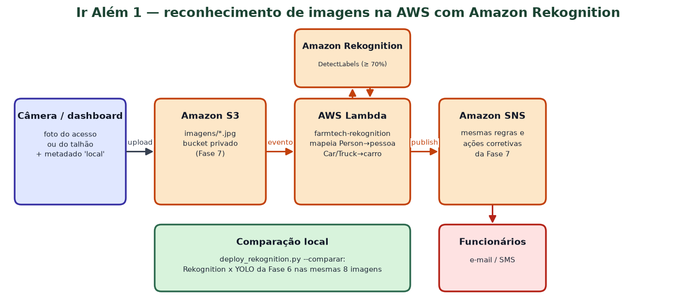
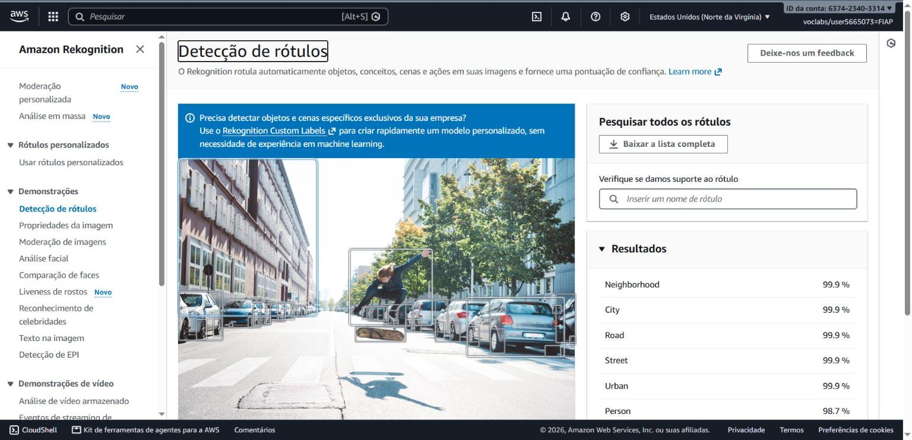
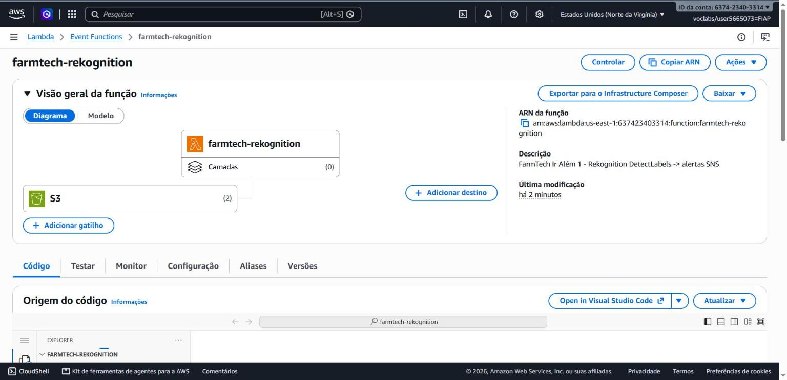
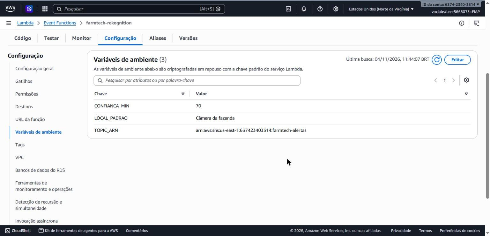
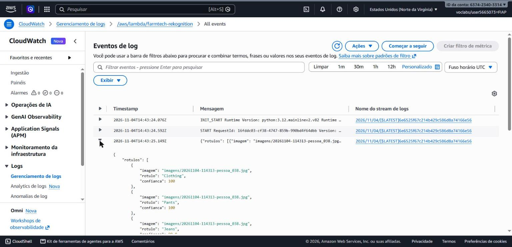
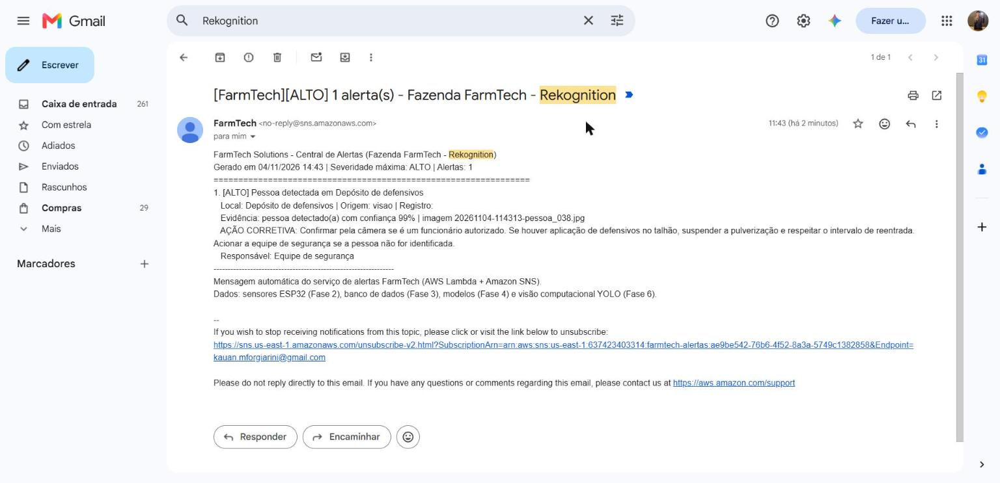
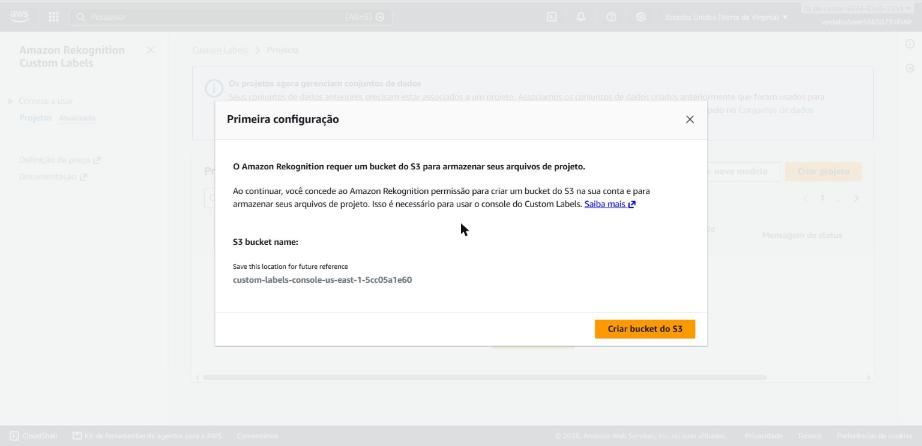
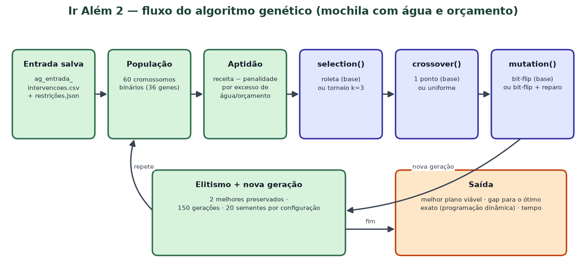
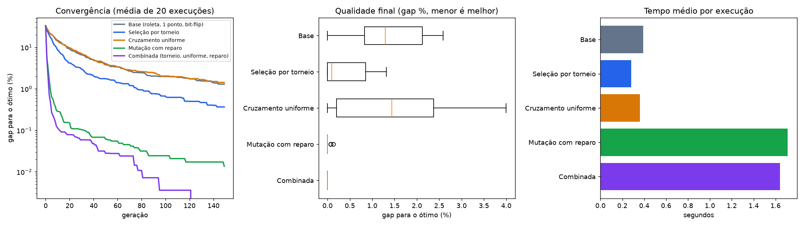
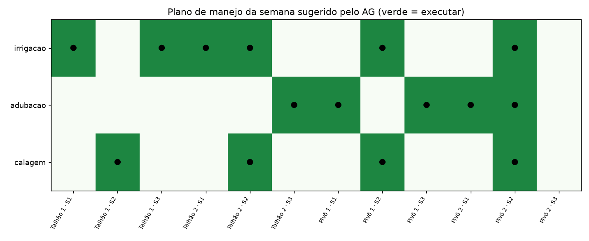

# IR ALÉM — Fase 7 (FarmTech Solutions · Grupo 27)

Kauan Maciel Forgiarini — RM 574005 · Wagner Adriano de Souza Silva Junior — RM 569431

| Desafio | Vídeo (YouTube, não listado, até 4 min) |
|---|---|
| Ir Além 1 — Integração de IA na AWS (Amazon Rekognition) | LINK_VIDEO_IR_ALEM_1 |
| Ir Além 2 — Otimização de recursos com algoritmo genético | LINK_VIDEO_IR_ALEM_2 |

```text
IR-ALEM/
├── src/rekognition/lambda_rekognition.py   ← Lambda: S3 imagens/ → Rekognition → regras → SNS
├── src/rekognition/deploy_rekognition.py   ← implantação, envio de imagem e comparação com o YOLO
├── src/gerar_entrada_ag.py                 ← gera (uma vez) a entrada do AG a partir da Fase 1
├── notebooks/ir_alem_2_algoritmo_genetico.ipynb
├── data/   ← entrada salva do AG, resultados e comparação Rekognition x YOLO
└── docs/   ← figuras autorais, gráficos e prints do console
```

---

## Ir Além 1 — Reconhecimento de imagens na AWS com Amazon Rekognition

### Arquitetura (figura autoral)

<p align="center"></p>

1. A câmera (ou a dashboard) envia a foto para o bucket da Fase 7 no prefixo `imagens/`, com o
   metadado `local` (ex.: "Depósito de defensivos").
2. O gatilho do S3 dispara a Lambda **`farmtech-rekognition`**, que chama
   **`DetectLabels`** (`MaxLabels=20`, `MinConfidence=70`) com a imagem direto do S3 (sem trafegar os
   bytes pela Lambda).
3. Os rótulos `Person/Human` viram `pessoa` e `Car/Vehicle/Truck/Pickup Truck/Tractor` viram `carro`,
   com uma detecção por `Instance` (caixa delimitadora) — o mesmo formato do YOLO da Fase 6.
4. As detecções passam pelas **mesmas regras** da Fase 7 (`regras_alerta.py`, empacotado junto) e o
   alerta com a ação corretiva sai pelo **mesmo tópico SNS**.

### Como executar

```bash
# pré-requisito: serviço da Fase 7 implantado (python farmtech.py aws-deploy --email ...)
python IR-ALEM/src/rekognition/deploy_rekognition.py                     # cria a Lambda e o gatilho imagens/
python IR-ALEM/src/rekognition/deploy_rekognition.py --enviar data/fase6_imagens_campo/pessoa_038.jpg --local "Depósito de defensivos"
python IR-ALEM/src/rekognition/deploy_rekognition.py --comparar          # Rekognition x YOLO nas 8 imagens
python IR-ALEM/src/rekognition/deploy_rekognition.py --remover
```

O deploy **preserva** os gatilhos `sensores/` e `visao/` da Fase 7 ao acrescentar `imagens/`.

### Prints do console (salvar em `docs/prints_rekognition/`)

| # | Print | Campos configurados e explicação |
|---|---|---|
| 1 |  | **Rekognition → Label detection (demo)** com uma foto da fazenda: rótulos *Person*, *Car* e a confiança de cada um — mostra o serviço funcionando na conta antes de qualquer código |
| 2 |  | **Lambda `farmtech-rekognition`**: runtime Python 3.12, 256 MB, 60 s, role `LabRole`, gatilho **S3** com prefixo `imagens/` e sufixo `.jpg`/`.png` |
| 3 |  | **Variáveis**: `TOPIC_ARN` (tópico da Fase 7), `CONFIANCA_MIN=70` (corte do `MinConfidence`), `LOCAL_PADRAO` |
| 4 |  | **CloudWatch Logs**: JSON com os rótulos devolvidos pelo Rekognition e a quantidade de detecções |
| 5 |  | **E-mail** "[FarmTech][ALTO] ... Rekognition" com a ação corretiva de pessoa detectada |
| 6 |  | **Rekognition Custom Labels → Primeira configuração**: o console pede um bucket S3 próprio (`custom-labels-console-us-east-1-...`) para guardar projetos e datasets. A configuração parou neste ponto, **antes da confirmação** |

**Por que o Custom Labels parou antes da confirmação:** os próximos passos seriam criar o projeto
(`farmtech-pessoa-carro`), importar do S3 as 64/8 imagens da Fase 6 com rótulos pelo nome da pasta
(`pessoa/`, `carro/`) e clicar em **Train model**. O treino custa cerca de US$ 1 por hora e a
inferência exige uma *inference unit* ligada (cerca de US$ 4 por hora), o que consumiria rapidamente
os US$ 50 do Learner Lab. O enunciado permite parar antes desse ponto. O DetectLabels genérico
(prints 1 a 5) foi implantado e funciona de ponta a ponta.

### Resultado medido: Rekognition x YOLO nas 8 imagens das câmeras

Executado com `deploy_rekognition.py --comparar` (dados em `data/rekognition_vs_yolo.csv`):

| Imagem | Classe real | Rekognition: pessoas / veículos | YOLO personalizado: pessoas / veículos | Latência Rekognition |
|---|---|---|---|---:|
| carro_037 | carro | 0 / 3 | 0 / 2 | 3.634 ms |
| carro_038 | carro | 1 / 1 | 0 / 1 | 1.946 ms |
| carro_039 | carro | 0 / 1 | 0 / 1 | 875 ms |
| carro_040 | carro | 0 / 4 | 0 / 3 | 613 ms |
| pessoa_037 | pessoa | 1 / 0 | 0 / 0 | 4.250 ms |
| pessoa_038 | pessoa | 1 / 0 | 0 / 1 | 3.200 ms |
| pessoa_039 | pessoa | 2 / 0 | 0 / 0 | 1.677 ms |
| pessoa_040 | pessoa | 1 / 3 | 3 / 3 | 1.144 ms |

- **Pessoa:** o Rekognition reconheceu pessoa nas **4 de 4** fotos de pessoa; o YOLO personalizado,
  em **1 de 4**.
- **Veículo:** os dois reconheceram veículo nas 4 fotos de carro.
- **Falso positivo:** o Rekognition viu 1 pessoa em `carro_038`; o YOLO viu um veículo em `pessoa_038`.
- **Latência:** o Rekognition levou de 0,6 s a 4,3 s por imagem (rede + API); o YOLO local leva
  cerca de 60 a 100 ms em CPU.

Pela Lambda, a foto `pessoa_038.jpg` enviada ao S3 com o local "Depósito de defensivos" gerou o
e-mail **[FarmTech][ALTO] Pessoa detectada em Depósito de defensivos**, com confiança de 99% (print 5).

### Justificativa crítica

| Critério | YOLO local (Fase 6) | Amazon Rekognition (DetectLabels) |
|---|---|---|
| Qualidade nas 8 imagens da fazenda | carro 4/4, pessoa 1/4 (modelo personalizado) | carro 4/4, **pessoa 4/4**, com 1 falso positivo de pessoa |
| Infraestrutura | CPU/GPU na fazenda, manutenção do modelo | gerenciado, sem servidor e sem treino |
| Latência | ~60–100 ms por imagem em CPU | 0,6 s a 4,3 s medidos (rede + API); depende da internet rural |
| Custo | hardware já existente | ≈ US$ 1 por 1.000 imagens (1.000 imagens/dia ≈ US$ 30/mês) |
| Privacidade (LGPD) | imagem não sai da propriedade | imagens de pessoas vão para a nuvem: usar `sa-east-1`, regra de ciclo de vida no S3 e aviso de monitoramento |
| Especialização | pode aprender classes da fazenda | genérico; especializar exige Custom Labels (treino e inferência cobrados por hora) |

**Conclusão:** para a FarmTech a melhor solução é **híbrida**: o YOLO roda na borda (portaria e
pivôs, sem depender de internet) e só os quadros com detecção de pessoa em área sensível sobem para o
S3, onde o Rekognition confirma o rótulo antes do alerta. Isso reduz custo (poucas imagens por dia),
reduz falsos alarmes e resolve o recall baixo de pessoa do modelo personalizado reproduzido em CPU,
enquanto o dataset da Fase 6 não é ampliado.

---

## Ir Além 2 — Otimização de recursos com algoritmo genético

Notebook: [notebooks/ir_alem_2_algoritmo_genetico.ipynb](notebooks/ir_alem_2_algoritmo_genetico.ipynb)
(executado, com todas as saídas).

### Problema
Escolher, entre **36 intervenções** (irrigação suplementar, adubação de cobertura e calagem em
12 setores dos talhões da Fase 1), o plano semanal que **maximiza a receita esperada** respeitando
**água disponível (5.650 m³)** e **orçamento (R$ 24.500)** — uma mochila binária com duas restrições
(2³⁶ ≈ 69 bilhões de combinações).

### Reprodutibilidade
`src/gerar_entrada_ag.py` (semente 574005) gera **uma vez** `data/ag_entrada_intervencoes.csv` e
`data/ag_restricoes.json`; o notebook só **lê** esses arquivos. Os experimentos usam as mesmas 20
sementes em todas as configurações. Como água e custo são múltiplos de 10 m³ e R$ 100, o **ótimo exato**
(R$ 44.480) é calculado por programação dinâmica e serve de régua de qualidade.

### Figura autoral

<p align="center"></p>

### Parâmetros e funções alteradas
População 60 (≈ 1,7 × genes), 150 gerações, cruzamento 0,85, mutação 1/36 por gene, elitismo 2,
fitness = receita − penalidade proporcional ao excesso de água/orçamento.

| Configuração | `selection()` | `crossover()` | `mutation()` | Gap médio p/ ótimo | Ótimo encontrado | Tempo médio |
|---|---|---|---|---:|---:|---:|
| Base | roleta | 1 ponto | bit-flip | 1,29% | 1/20 | 0,37 s |
| Seleção por torneio | **torneio k=3** | 1 ponto | bit-flip | 0,37% | 9/20 | 0,28 s |
| Cruzamento uniforme | roleta | **uniforme** | bit-flip | 1,42% | 2/20 | 0,34 s |
| Mutação com reparo | roleta | 1 ponto | **bit-flip + reparo guloso** | 0,01% | 17/20 | 1,78 s |
| **Combinada** | torneio | uniforme | reparo | **0,00%** | **20/20** | 1,62 s |

<p align="center"></p>
<p align="center"></p>

**Leitura dos resultados:** o torneio melhora qualidade **e** tempo; o cruzamento uniforme sozinho
piora (gera mais filhos inviáveis); o reparo guloso é o maior ganho de qualidade, ao custo de ~5× mais
tempo; combinados, encontram o ótimo em todas as execuções e convergem na metade das gerações.
O plano ótimo executa 15 intervenções (6 irrigações, 5 adubações, 4 calagens), usa toda a água e
R$ 24.400 do orçamento. Discussão completa e limitações na seção 7 do notebook.

### Como executar

```bash
python IR-ALEM/src/gerar_entrada_ag.py          # opcional: os arquivos já estão versionados
jupyter notebook IR-ALEM/notebooks/ir_alem_2_algoritmo_genetico.ipynb
```
