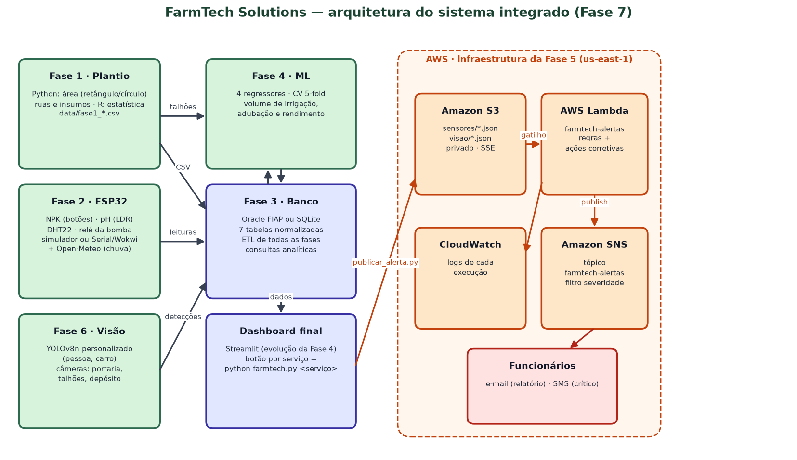
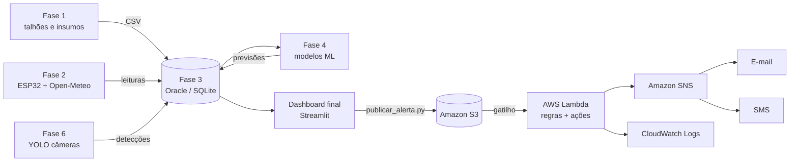
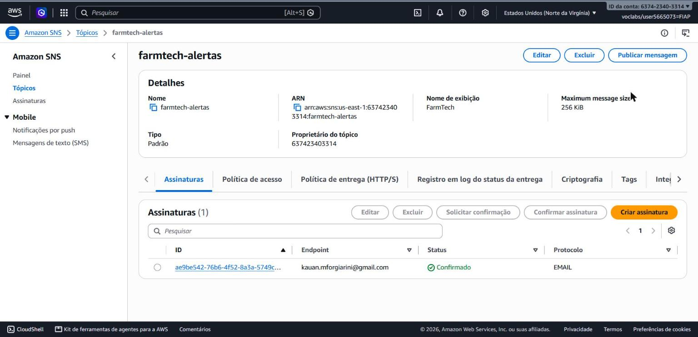
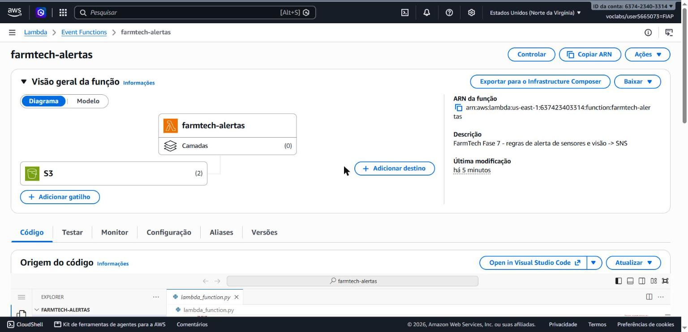
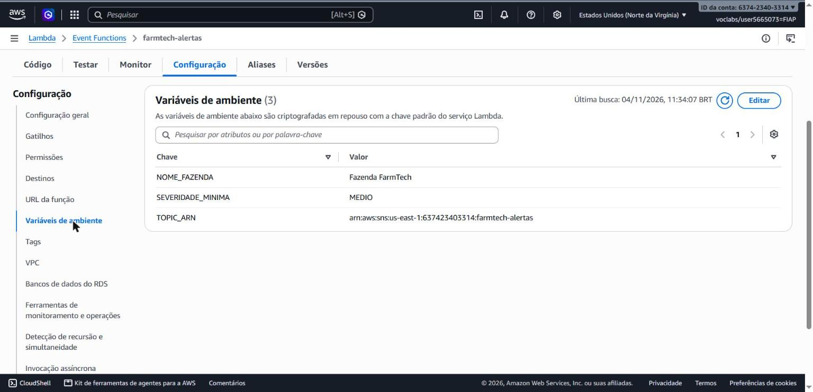
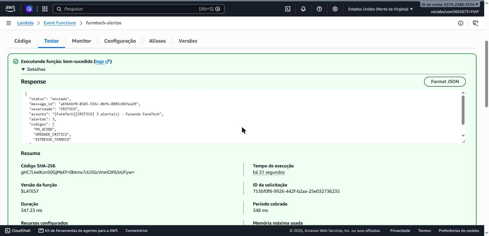
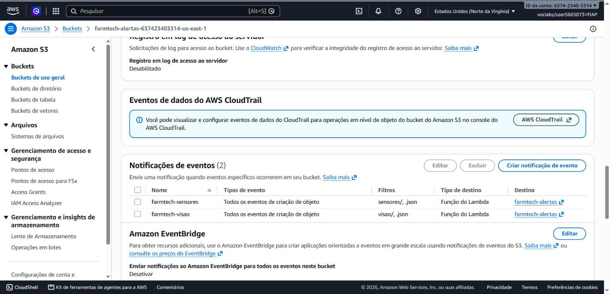
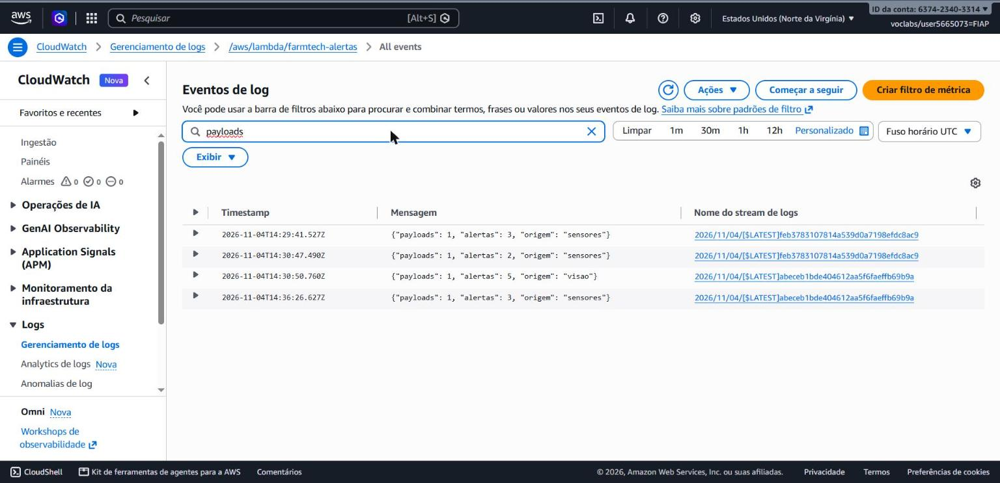
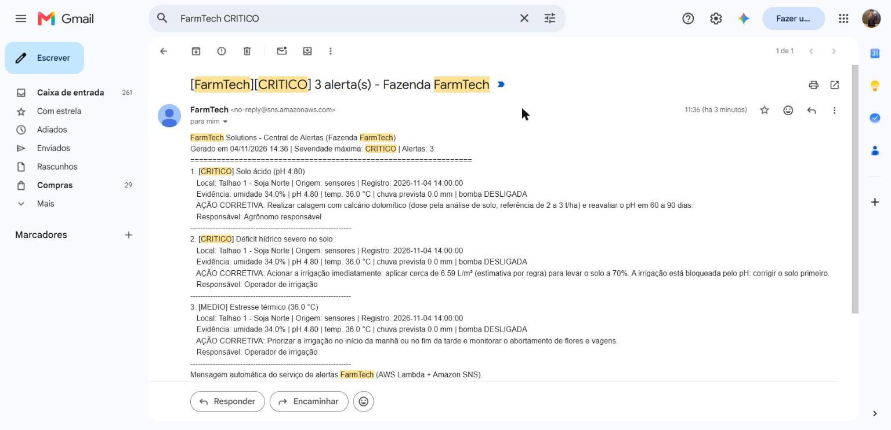

# FIAP - Faculdade de Informática e Administração Paulista

<p align="center">
<a href="https://www.fiap.com.br/">
  
</a>
</p>

<br>

# FarmTech Solutions — A consolidação de um sistema (Fase 7, Cap. 1)

## Grupo 27

## 👨‍🎓 Integrantes:
- <a href="https://github.com/KauanForgiarini">Kauan Maciel Forgiarini</a> — RM 574005
- Wagner Adriano de Souza Silva Junior — RM 569431

## 👩‍🏫 Professores:

### Tutor(a)
- Sabrina Otoni

### Coordenador(a)
- <a href="https://www.linkedin.com/in/andregodoichiovato/">André Godoi Chiovato</a>

### 🎥 Vídeos da entrega (YouTube, não listados)

| Vídeo | Link |
|---|---|
| Sistema integrado + alertas AWS (principal) | https://www.youtube.com/watch?v=G_NbZXSttco |
| Ir Além 1 — Amazon Rekognition | https://youtu.be/vNi8Qp7MON0 |
| Ir Além 2 — Algoritmo genético | https://youtu.be/sV19-E6zK7o |

---

## 📜 Descrição

Ao longo do ano a FarmTech Solutions construiu peças separadas de uma solução de Agricultura 4.0.
Nesta fase elas viram **um único sistema de gestão da fazenda**, em **uma única pasta de projeto**,
operado por **uma dashboard** (evolução da dashboard da Fase 4) que dispara cada serviço por
**botão** ou pelo **mesmo comando de terminal** (`python farmtech.py <serviço>`). Um **serviço de
mensageria na AWS** monitora os sensores e a visão computacional e envia aos funcionários, por
**e-mail e SMS**, os alertas com as **ações corretivas**.

| Fase | O que foi construído | Onde está nesta pasta | Como dispara |
|---|---|---|---|
| 1 | Base de dados de plantio (área por figura geométrica, ruas, insumos) em **Python** e estatística em **R** | `src/fase1_plantio_insumos/` | `python farmtech.py fase1` · `fase1-estatistica` |
| 2 | **ESP32** (Wokwi): NPK, pH (LDR), umidade (DHT22), relé da bomba e previsão de chuva (Open-Meteo) | `src/fase2_iot_irrigacao/` | `python farmtech.py fase2` |
| 3 | Banco relacional **Oracle** (FIAP) ou SQLite, ETL de todas as fases e consultas | `src/fase3_banco_dados/` | `python farmtech.py fase3` |
| 4 | **Dashboard** Streamlit + modelos de regressão Scikit-Learn | `src/dashboard/` · `src/fase4_modelos_preditivos/` | `python farmtech.py dashboard` · `fase4` |
| 5 | Infraestrutura, custos e **segurança na AWS** | `src/fase5_infra_aws/` | página "Fase 5" |
| 6 | **Visão computacional YOLO** (pessoa e carro) | `src/fase6_visao_computacional/` | `python farmtech.py fase6` |
| 7 | **Alertas na AWS**: S3 → Lambda → SNS (e-mail/SMS) | `src/fase7_alertas_aws/` | `python farmtech.py alertas` |

O sistema é **orientado a dados, não à cultura**: talhões, limites agronômicos, câmeras e regras ficam
em arquivos e dicionários (`data/`, `regras_alerta.py`). Trocando esses dados, a mesma estrutura serve
a outro setor (ex.: uma granja trocaria umidade do solo por temperatura do aviário e "pessoa no
depósito de defensivos" por "pessoa na área de biossegurança").

### Arquitetura

<p align="center"></p>



---

## 🧭 Percorrendo o sistema, fase a fase

### Fase 1 — Plantio, insumos e análise em R
`src/fase1_plantio_insumos/farmtech_fase1.py` mantém os talhões em **vetores (listas)** com menu de
**entrada, saída, atualização, deleção e saída**. Duas culturas:

| Cultura | Figura | Área | Ruas | Insumos (dose) |
|---|---|---|---|---|
| Soja | retângulo | comprimento × largura | largura ÷ 0,50 m | MAP 200 kg/ha, KCl 100 kg/ha, glifosato 3 L/ha, fungicida 0,5 mL/m |
| Milho | círculo (pivô central) | π × raio² | diâmetro ÷ 0,80 m | NPK 08-28-16 350 kg/ha, ureia 250 kg/ha, inseticida 0,3 mL/m |

Os 4 talhões de exemplo somam **54,81 ha**. O programa exporta `data/fase1_talhoes.csv` e
`data/fase1_insumos.csv`, lidos pelo banco (Fase 3) e pelo script **R** `analise_estatistica.R`
(média, desvio padrão, mediana, mínimo, máximo e coeficiente de variação por cultura e dos sensores,
gráfico em `docs/evidencias/` e clima atual via Open-Meteo quando o pacote `jsonlite` existe).
O orquestrador `analise_estatistica.py` usa o `Rscript` se instalado; sem R, aplica as mesmas
fórmulas em Python, para a dashboard funcionar em qualquer máquina.

### Fase 2 — ESP32 e irrigação automática
- Firmware `esp32/farmtech_irrigacao/farmtech_irrigacao.ino` + `diagram.json` (Wokwi).
  Revisado nesta fase: pinos alinhados ao diagrama (P = GPIO13, K = GPIO14), leitura da temperatura
  corrigida e limiares sincronizados com o resto do sistema.
- Regra da bomba (idêntica em C++ e em Python, `decidir_irrigacao()`): não irriga com chuva prevista,
  solo saturado (≥ 80%), pH fora de 5,0–7,5 ou umidade ≥ 60%; irriga se o solo está seco e há P ou K.
- `simulador_esp32.py` gera as leituras horárias com a física do talhão (evapotranspiração pela
  temperatura, chuva, irrigação, consumo de NPK e deriva do pH) em 5 cenários (`realista`, `normal`,
  `seca`, `acidez`, `saturacao`) para demonstrar cada alerta. Com `--serial COM3` ou
  `--serial rfc2217://localhost:4000` lê o ESP32 real ou o **Wokwi for VS Code** e envia a ele a
  previsão de chuva da **Open-Meteo** (`clima_open_meteo.py`).
- Um teste automatizado garante que todas as leituras simuladas seguem a regra do firmware.

### Fase 3 — Banco de dados relacional
O modelo da Fase 3 (uma tabela `SENSOR_FARMTECH`) foi **normalizado** para receber todas as fases:

```
CULTURA (1) ──< TALHAO (1) ──< APLICACAO_INSUMO             ← Fase 1
                   └──< LEITURA_SENSOR (1) ── (1) PREVISAO_ML ← Fases 2 e 4
DETECCAO_VISAO  ← Fase 6          ALERTA  ← Fase 7
```

- DDL Oracle: `sql/oracle/01_ddl_farmtech.sql` (PK, FK, CHECK, índices e comentários) e o equivalente
  `sql/sqlite_schema.sql`.
- `carga_banco.py` é o **ETL**: recria o esquema e carrega os CSVs de todos os serviços. Os serviços
  que produzem dados disparam o ETL automaticamente ao terminar.
- `sql/consultas.sql`: 8 consultas analíticas em SQL padrão (rodam iguais no Oracle e no SQLite),
  lidas pela dashboard.
- Backend escolhido por `FARMTECH_DB` no `.env`: `sqlite` (padrão) ou `oracle` (`oracle.fiap.com.br`,
  driver `oracledb` em modo thin, sem Instant Client).

### Fase 4 — Dashboard e modelos preditivos
`src/fase4_modelos_preditivos/treinar_modelos.py` treina Regressão Linear, Ridge, Random Forest e
Gradient Boosting (pipeline com `StandardScaler`, divisão 80/20 e **validação cruzada 5-fold**) para
três alvos e escolhe o melhor pelo CV-R²:

| Alvo | Melhor modelo | CV-R² | MAE (teste) |
|---|---|---:|---:|
| Volume de irrigação (L/m²) | Gradient Boosting | 0,835 | 0,34 |
| Necessidade de fertilização (kg/ha) | Gradient Boosting | 0,847 | 1,71 |
| Rendimento esperado (sc/ha) | Gradient Boosting | 0,761 | 2,06 |

Os modelos preveem cada leitura do ESP32 (`data/fase4_previsoes.csv` → tabela `PREVISAO_ML`) e o
**volume de irrigação previsto entra na ação corretiva do alerta** de déficit hídrico.
A dashboard da Fase 4 virou a **dashboard final** (`src/dashboard/`), com uma página por fase.

### Fase 5 — Infraestrutura e segurança na AWS
A estimativa da Fase 5 (EC2 `t3.micro` + EBS: US$ 11,59/mês em us-east-1 e US$ 19,86/mês em
sa-east-1, com escolha de São Paulo pela restrição de manter os dados no Brasil) é a base de nuvem.
Para os alertas foi adotada uma arquitetura **serverless** (Lambda + SNS + S3), que custa centavos por
mês no volume da fazenda. Controles de segurança aplicados:

- credenciais fora do código (`~/.aws/credentials` do Learner Lab; `.env` e `data/aws_config.json` no
  `.gitignore`);
- bucket S3 privado (Block Public Access), criptografia SSE-S3 e política que **nega acesso sem HTTPS**;
- Lambda com a `LabRole` (o Learner Lab não permite criar roles) e política de **menor privilégio**
  pronta para produção em `src/fase5_infra_aws/politica_minimo_privilegio.json`;
- assinaturas SNS com confirmação do destinatário, filtro por severidade no SMS e criptografia opcional
  com a chave KMS gerenciada `aws/sns`; logs no CloudWatch para auditoria;
- região **us-east-1** no Learner Lab (a conta de estudante só libera us-east-1 e us-west-2); em
  produção, **sa-east-1**, coerente com a decisão da Fase 5.

### Fase 6 — Visão computacional (YOLO)
- `treinar_yolo.py` reproduz a configuração vencedora da Fase 6 (YOLOv8n pré-treinado, 30 épocas,
  SGD, semente 42) sobre o mesmo dataset de 80 imagens do Open Images V7 (`data/fase6_dataset/`,
  64/8/8, origem em `fontes_openimages.csv`). Os pesos ficam em
  `src/fase6_visao_computacional/modelos/yolo_farmtech_30ep.pt`.
- `detectar.py` processa as câmeras (`data/fase6_imagens_campo/` + `cameras.json` com o local de cada
  câmera: portaria, talhões, depósito de defensivos, galpão), salva as imagens anotadas em
  `data/fase6_resultados/` e as detecções em `DETECCAO_VISAO`. A dashboard também aceita upload de foto.

| Treino | Ambiente | Precision | Recall | mAP50 | mAP50-95 |
|---|---|---:|---:|---:|---:|
| Fase 6 original | Colab, GPU T4 | 0,912 | 0,556 | 0,609 | 0,455 |
| Reprodução na Fase 7 | CPU local, 610 s | 0,972 | 0,384 | 0,485 | 0,375 |

**Análise crítica:** a reprodução em CPU não repetiu exatamente os números do Colab (o treino com
80 imagens é muito sensível a não determinismo de hardware). Nas 8 imagens de câmera, o modelo
personalizado reconheceu veículo nas 4 fotos de carro, mas pessoa em apenas 1 das 4 fotos de pessoa;
o YOLOv8n do COCO (baseline) reconheceu as 8. Para um alerta de **segurança**, perder uma pessoa é o
erro mais grave, por isso a dashboard permite trocar o modelo (personalizado ou baseline) e o Ir Além 1
compara com o Amazon Rekognition. O próximo passo é ampliar o dataset de pessoas em cenas rurais.

### Fase 7 — Serviço de alertas na AWS
**Fluxo:** `publicar_alerta.py` lê do banco as últimas leituras (já com a previsão da Fase 4) e as
detecções da Fase 6 → grava o evento JSON no **S3** (`sensores/` ou `visao/`) → o **gatilho do S3**
dispara a **Lambda** `farmtech-alertas` → a Lambda aplica as regras e publica no **SNS** → o SNS
entrega **e-mail** (relatório completo) e **SMS** (resumo, só ALTO/CRÍTICO via filtro de atributos).
Também é possível invocar a Lambda diretamente (`--modo lambda`) ou publicar direto no SNS (`--modo sns`).

As regras ficam em um único arquivo, `lambda_alertas/regras_alerta.py`, usado pela Lambda, pelo
firmware (mesmos limiares), pelo simulador e pela dashboard:

| Código | Origem | Severidade | Condição | Ação corretiva enviada |
|---|---|---|---|---|
| `UMIDADE_CRITICA` | sensores | CRÍTICO | umidade < 40% | irrigar o volume previsto pelo modelo da Fase 4; se a bomba já está ligada, inspecionar vazão e entupimentos |
| `IRRIGACAO_BLOQUEADA_NPK` | sensores | ALTO | solo seco e P e K ausentes | adubação fosfatada e potássica; a irrigação é liberada em seguida |
| `SOLO_SATURADO` | sensores | MÉDIO | umidade ≥ 80% | bomba desligada, checar drenagem, evitar máquinas, vigiar doenças fúngicas |
| `PH_ACIDO` / `PH_ALCALINO` | sensores | ALTO (CRÍTICO se bloqueia a irrigação) | pH < 5,5 / > 7,0 | calagem com calcário dolomítico / enxofre ou gesso |
| `NITROGENIO_BAIXO` | sensores | MÉDIO | N ausente | verificar nodulação/inoculação (soja) ou ureia em cobertura (milho) |
| `ESTRESSE_TERMICO` | sensores | MÉDIO | temperatura > 35 °C | irrigar no início da manhã/fim da tarde |
| `CHUVA_FORTE` | sensores | MÉDIO | chuva prevista ≥ 20 mm | adiar pulverização e adubação de cobertura |
| `PESSOA_DETECTADA` | visão | ALTO | pessoa com confiança ≥ 50% | confirmar identidade; suspender pulverização (intervalo de reentrada); acionar segurança |
| `VEICULO_DETECTADO` | visão | MÉDIO | veículo com confiança ≥ 50% | conferir agenda de entradas, registrar placa e horário |

Alertas repetidos são **consolidados** (ex.: "repetido 6x") para não lotar a caixa de entrada; o
assunto do e-mail é ASCII com menos de 100 caracteres (exigência do SNS) e cada envio é registrado na
tabela `ALERTA` com canal, status e `MessageId`.

**Implantação no AWS Academy Learner Lab** (passo a passo e lista de prints em
[docs/aws/GUIA_AWS.md](docs/aws/GUIA_AWS.md)):

```bash
python farmtech.py aws-deploy --email funcionario@fazenda.com.br [--telefone +5555999999999]
python farmtech.py aws-deploy --testar       # invoca a Lambda com um evento crítico
python farmtech.py alertas --modo s3         # fluxo completo S3 -> Lambda -> SNS
```

#### Prints do console da AWS

| # | Tela | O que comprova |
|---|---|---|
| 1 |  | Tópico `farmtech-alertas` e assinatura de e-mail **confirmada** (e SMS com filtro de severidade) |
| 2 |  | Função `farmtech-alertas` com o gatilho do S3 e o código `lambda_function.py` + `regras_alerta.py` |
| 3 |  | Variáveis `TOPIC_ARN`, `SEVERIDADE_MINIMA`, runtime Python 3.12 e role `LabRole` |
| 4 |  | Evento de teste crítico retornando `"status": "enviado"` e o `message_id` |
| 5 |  | Bucket privado com os eventos `sensores/*.json` e `visao/*.json` e a notificação de evento |
| 6 |  | Log da execução disparada pelo S3 (payloads, alertas, origem) |
| 7 |  | E-mail recebido pelo funcionário com as ações corretivas |

---

## 📁 Estrutura de pastas

```text
CAP-1-A-CONSOLIDACAO-DE-UM-SISTEMA/      ← pasta única do projeto (abrir no VS Code)
├── farmtech.py                          ← lançador: python farmtech.py <serviço>
├── requirements.txt · .env.example
├── .vscode/                             ← tarefas (Terminal > Run Task) para cada serviço
├── data/                                ← área de troca entre as fases (CSV/JSON) e dataset da Fase 6
├── docs/                                ← arquitetura, guia AWS, prints, evidências, roteiro do vídeo
├── notebooks/                           ← notebooks originais das Fases 5 e 6 (histórico)
├── src/
│   ├── farmtech_core/                   ← caminhos, .env e catálogo de serviços (terminal = botão)
│   ├── fase1_plantio_insumos/           ← Python (CRUD de talhões e insumos) + R (estatística)
│   ├── fase2_iot_irrigacao/             ← firmware ESP32, diagram.json, simulador/Serial, Open-Meteo
│   ├── fase3_banco_dados/               ← DDL Oracle/SQLite, ETL, consultas
│   ├── fase4_modelos_preditivos/        ← treino/previsão Scikit-Learn (+ motor C++ da Fase 4)
│   ├── fase5_infra_aws/                 ← política IAM de menor privilégio e custos
│   ├── fase6_visao_computacional/       ← treino YOLO e serviço de detecção
│   ├── fase7_alertas_aws/               ← Lambda + regras, deploy boto3, publicador de alertas
│   └── dashboard/                       ← dashboard final (uma página por fase)
├── tests/                               ← 16 testes (regras, Lambda com AWS simulada, integração)
└── IR-ALEM/                             ← Ir Além 1 (Rekognition) e Ir Além 2 (algoritmo genético)
```

## 🔧 Como executar o código

**Pré-requisitos:** Python 3.11+ (testado com 3.14 no Windows 10), Git. Opcionais: R 4.x (estatística
da Fase 1), conta AWS Academy Learner Lab (Fase 7), acesso ao Oracle da FIAP, Wokwi.

```bash
git clone https://github.com/KauanForgiarini/farmtech-fase7.git
cd farmtech-fase7/1TIAO/FASE7/CAP-1-A-CONSOLIDACAO-DE-UM-SISTEMA
python -m venv .venv
.venv\Scripts\activate            # Linux/macOS: source .venv/bin/activate
python -m pip install -r requirements.txt
```

```bash
python farmtech.py --listar       # catálogo de serviços
python farmtech.py pipeline       # Fases 1 → 2 → estatística → 4 → 6 → alertas → 3 (consultas)
python farmtech.py dashboard      # abre http://localhost:8501
```

Cada fase também roda sozinha, com argumentos próprios:

```bash
python farmtech.py fase1 --menu                                   # menu interativo da Fase 1
python farmtech.py fase2 --leituras 72 --cenario seca --clima     # cenário de seca + chuva real
python farmtech.py fase3 --backend oracle                         # mesmo ETL no Oracle da FIAP
python farmtech.py fase6 --imagens foto.jpg --local "Portaria"
python farmtech.py alertas --modo local                           # sem AWS: mostra e-mail e SMS
python -m pytest tests                                            # testes automatizados
```

No VS Code, os mesmos comandos estão em **Terminal → Run Task** (`.vscode/tasks.json`).

## 📎 Links e Observações

### 🔗 Links do Projeto
* **Vídeo principal (YouTube, não listado)**: LINK_VIDEO_PRINCIPAL
* **Ir Além**: [IR-ALEM/README.md](IR-ALEM/README.md)
* **Repositórios das fases anteriores**: [Fase 2](https://github.com/KauanForgiarini/FarmTech) ·
  [Fase 3](https://github.com/KauanForgiarini/farmtech-crop-monitor) ·
  [Fase 4](https://github.com/KauanForgiarini/farmtech-data-pipeline) ·
  [Fase 5](https://github.com/KauanForgiarini/farmtech-fase5-ml) ·
  [Fase 6](https://github.com/KauanForgiarini/farmtech-fase6)

### 🧠 Decisões Técnicas

> **Serviços como programas independentes + catálogo único.** Cada fase continua sendo um programa
> próprio (pode ser executado, testado e entregue sozinho). `farmtech_core/servicos.py` registra todos
> e é usado tanto pelo terminal (`farmtech.py`) quanto pelos botões da dashboard, garantindo que
> "botão" e "comando" executem exatamente a mesma coisa.
>
> **Arquivos em `data/` como contrato entre fases e banco como fonte consolidada.** Cada serviço grava
> seu CSV; o ETL da Fase 3 consolida no banco relacional. Isso desacopla as fases e permite rodar o
> mesmo sistema em SQLite (sem rede) ou no Oracle da FIAP apenas trocando uma variável.
>
> **Regras de alerta em Python puro, sem dependências.** O mesmo arquivo roda na Lambda, nos testes e
> na dashboard (prévia do e-mail antes de enviar), e concentra os limiares usados pelo firmware.
>
> **Serverless orientado a eventos na AWS.** S3 + Lambda + SNS não exigem servidor ligado, escalam
> sozinhos e custam centavos; o SNS resolve e-mail e SMS no mesmo tópico, com filtro por severidade.
>
> **Streamlit** foi mantido da Fase 4 por permitir uma interface completa em Python e chamar os
> serviços como subprocessos.

### 📢 Observações Gerais
- Dados de sensores simulados com semente fixa (RM 574005) para reprodutibilidade; o simulador segue a
  mesma regra do firmware, validada por teste automatizado.
- O dataset da Fase 6 vem do Open Images V7 (imagens CC BY 2.0, anotações CC BY 4.0) e é usado apenas
  para fins acadêmicos; a origem de cada imagem está em `data/fase6_dataset/fontes_openimages.csv`.
- Detectar uma pessoa ou um veículo **não** permite inferir identidade nem intenção: o alerta pede
  confirmação humana antes de qualquer ação.

---

## 📋 Licença

<p xmlns:cc="http://creativecommons.org/ns#" xmlns:dct="http://purl.org/dc/terms/"><a property="dct:title" rel="cc:attributionURL" href="https://github.com/fiap-tutoria/FIAP-PORTFOLIO-AI">TEMPLATE - FIAP PORTFÓLIO AI</a> por <a rel="cc:attributionURL dct:creator" property="cc:attributionName" href="https://fiap.com.br">FIAP</a> está licenciado sobre <a href="http://creativecommons.org/licenses/by/4.0/?ref=chooser-v1" target="_blank" rel="license noopener noreferrer" style="display:inline-block;">Attribution 4.0 International</a>.</p>
